# Manhwa AI Studio — End-to-End Autonomous Manhwa Video Production Suite

A complete, modular **AI-driven manhwa video production and publishing monorepo** that turns raw webtoon/manhwa chapters into **4K-upscaled, lip-synced, avatar-hosted YouTube Long Videos & 2K Shorts** — and publishes them autonomously to YouTube with custom thumbnails, SEO metadata, and related-video linking.

---

## Architecture Overview

This monorepo combines three standalone engines into one unified pipeline designed to be orchestrated by an AI coding/production agent (such as **Antigravity**, Claude Code, or Cursor):

```mermaid
flowchart LR
    A["1. automate_recordingchapters\n(Manhwa Recorder GUI)"] -->|"chapter-001.mp4\nmetadata.json"| B["AI Production Agent\n(Panel Extraction + 4x Real-ESRGAN\n+ Script + Kokoro-82M TTS + SFX)"]
    B -->|"Synced Voiceover\n+ .ava Timeline"| C["2. avatarscript\n(2D Avatar Animation Engine)"]
    C -->|"Lip-Synced Host +\nFiery Explode & Reassemble"| D["FFmpeg Video Composer\n(1080p Long + 2K 9:16 Short\n+ 1-Line Subtitle Pills)"]
    D -->|"Master MP4 + Short MP4\n+ Custom Thumbnails\n+ Metadata JSON"| E["3. manhwa-publisher\n(YouTube Data API v3 CLI)"]
    E -->|"Public / Scheduled"| F["YouTube Channel\n(Long Video + Linked Short)"]
```



| Module | Directory | Responsibility |
| :--- | :--- | :--- |
| **1. Manhwa Recorder** | [`automate_recordingchapters/`](automate_recordingchapters/) | PySide6 + Playwright + FFmpeg desktop app that automatically opens manhwa chapters in Chrome/Edge, preloads lazy images, scrolls smoothly, crops the comic strip (`auto_comic`), and outputs `chapter-XXX.mp4` + `metadata.json`. |
| **2. AvatarScript** | [`avatarscript/`](avatarscript/) | Deterministic 2D avatar animation DSL (`.ava`) & Python renderer supporting RGBA PNG/SVG character rigs (e.g., `pixel_narrator`, `flame_emperor`, `kenney_host`), audio lip-sync (`talk audio:...`), energy auras, and dynamic fiery `explode` & reassembly effects. |
| **3. Manhwa Publisher** | [`manhwa-publisher/`](manhwa-publisher/) | Production-ready YouTube Data API v3 CLI with OAuth 2.0, `ffprobe` validation, resumable uploads, custom thumbnail setting, `--related-video-id` Short-to-Long linking, SQLite duplicate prevention, and scheduling. |

---

## How to Use This Suite with an AI Agent

The real power of **Manhwa AI Studio** is letting an AI agent drive the entire pipeline from raw chapter recording to live YouTube publication.

### Step 1: Record the Chapter (`automate_recordingchapters`)
Launch the desktop recorder to capture the chapter cleanly:
```powershell
cd automate_recordingchapters
python -m venv .venv
.\.venv\Scripts\Activate.ps1
pip install -r manhwa_recorder/requirements.txt
playwright install chromium
.\.venv\Scripts\python -m manhwa_recorder
```
Enter the series name, chapter number/range, and URL → click **Start Recording**. It outputs:
```text
output/<Series-Name>/Chapter-001/
├── chapter-001.mp4
├── metadata.json
└── recording.log
```

### Step 2: Prompt Your AI Agent to Produce the Videos
Open this workspace in your AI agent (e.g., Antigravity) and point it at the recorded chapter folder. Example prompt:

> *"Produce a 1080p Long Video and a 2K 9:16 YouTube Short from `output/My-Manhwa/Chapter-001/chapter-001.mp4`.*
> - *Extract all unique panels (never holding any panel >5s, and ensure no character faces are cut off).*
> - *Upscale panels 4x with Real-ESRGAN (`realesrgan-x4plus-anime`).*
> - *Generate a clear, well-paced voiceover using local Kokoro-82M (`am_adam` with emotion tags `[narrator]`, `[ominous]`, `[shock]`, `[comedy]`, `[hype]`, `[whisper]`) + SFX + BGM.*
> - *Composite AvatarScript character `pixel_narrator` with lip-sync and fiery `explode` animations at the peak twist beats.*
> - *Render bite-sized 1-line lower-third subtitle pills via FFmpeg `libass` (never multi-line text blocks).*
> - *Generate 50/50 split-screen Long & Short thumbnails with a curved arrow sticker, then publish both as Public using `manhwa-publisher`."*

### What the AI Agent Automatically Orchestrates:
1. **Visual & Dialogue Extraction:** Samples `chapter-001.mp4`, verifies unclipped character faces via contact sheets, and transcribes dialogue bubbles (OCR or visual reading).
2. **4K Panel Restoration:** Runs `realesrgan-ncnn-vulkan` (`realesrgan-x4plus-anime`) to upscale 720×1080 captures to razor-sharp 2880×4320 artwork.
3. **Expressive Local TTS & Sound Design:** Synthesizes tagged narration with **Kokoro-82M**, mixes procedural/layered SFX (`boom`, `explode_blast`, `dramatic_stinger`, `record_pop`, `sparkle_heart`) + ominous-to-comedy BGM, and generates synced `.srt` subtitle pills.
4. **AvatarScript Integration (`avatarscript`):**
   Compiles a declarative `.ava` timeline directly in Python:
   ```python
   from avatarscript.compiler.compiler import AvatarCompiler
   from avatarscript.renderer.frame_renderer import FrameRenderer
   from avatarscript.runtime.timeline import iter_scene_frames
   ```
   Composites the transparent RGBA avatar frames (e.g., `pixel_narrator` holding `streamer_mic`, reacting with `expression shocked`, and firing `explode duration 2.4s ... fire:true`) over the keyframed motion-comic panels.
5. **High-CTR Thumbnails & Metadata:** Generates 1920×1080 Long and 1080×1920 Short thumbnails + SEO-optimized `youtube_publishing_metadata.json` and `youtube_short_metadata.json`.

### Step 3: Autonomous YouTube Publishing (`manhwa-publisher`)
Set up OAuth 2.0 once (see [`manhwa-publisher/README.md`](manhwa-publisher/README.md)):
```powershell
cd manhwa-publisher
python -m venv .venv
.\.venv\Scripts\Activate.ps1
pip install -r requirements.txt
# Save Google Cloud Desktop OAuth JSON to credentials/client_secrets.json
python -m publisher auth
python -m publisher doctor
```

Then either you or the AI agent publishes both videos with automatic Short-to-Long linking:
```powershell
# 1. Publish Long Video (returns video_id, e.g. R5ouqM5Ev-E)
.\.venv\Scripts\python.exe -m publisher publish `
  --video "..\content\my_ch1\Long_1080p_HQ.mp4" `
  --metadata "..\content\my_ch1\youtube_publishing_metadata.json" `
  --now --visibility public --approve --json

# 2. Publish 2K Short linked directly to the Long Video
.\.venv\Scripts\python.exe -m publisher publish `
  --video "..\content\my_ch1\Short_2K_HQ.mp4" `
  --metadata "..\content\my_ch1\youtube_short_metadata.json" `
  --related-video-id "<LONG_VIDEO_ID>" `
  --now --visibility public --approve --json
```

---

## AI Agent Workflow Tips & Best Practices

See [`AI_WORKFLOW_GUIDE.md`](AI_WORKFLOW_GUIDE.md) for a complete prompt cookbook, Kokoro-82M emotion tag reference, AvatarScript `.ava` templates, and quality-control checklists (preventing cropped faces, giant subtitle blocks, and YouTube API rate limits).

---

## Repository Structure

```text
manhwa-ai-studio/
├── README.md                     # This overview & AI orchestration guide
├── AI_WORKFLOW_GUIDE.md          # Detailed AI prompts, TTS tags, QC checklist
├── .gitignore                    # Protects OAuth tokens, browser profiles & large media
├── automate_recordingchapters/   # Module 1: Manhwa Recorder (PySide6 + Playwright + FFmpeg)
├── avatarscript/                 # Module 2: AvatarScript 2D Animation Engine & DSL
└── manhwa-publisher/             # Module 3: Autonomous YouTube Data API v3 CLI
```

---

## Prerequisites (Windows 10/11)

- **Python 3.11+**
- **FFmpeg & FFprobe** (`winget install Gyan.FFmpeg`)
- **Google Chrome or Microsoft Edge** (for Manhwa Recorder)
- **Optional Local AI Tools:**
  - `kokoro-onnx` + `soundfile` (local 24kHz expressive TTS)
  - `realesrgan-ncnn-vulkan` (GPU 4x anime upscaling)
  - `easyocr` (optional speech-bubble OCR)

---

## Licensing

Each sub-module retains its respective license inside its subdirectory:
- `automate_recordingchapters/LICENSE` — MIT License
- `manhwa-publisher/LICENSE` — MIT License
- `avatarscript/LICENSE` — Custom / Permission Required (see `avatarscript/LICENSE`)
