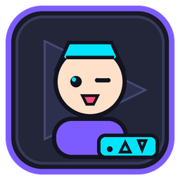
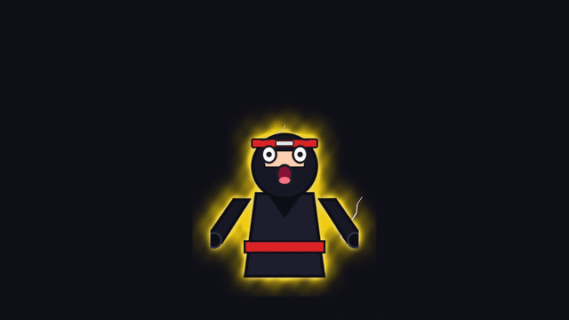
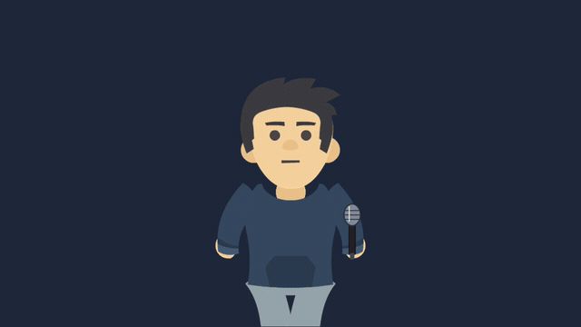
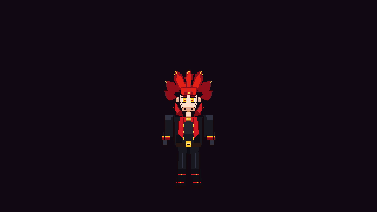
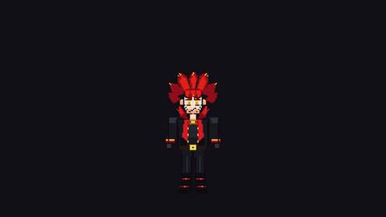

<p align="center">
  
</p>

<h1 align="center">AvatarScript</h1>

<p align="center">
  <strong>A deterministic animation engine & domain-specific language for 2D reaction avatars, VTubers, and commentary videos.</strong>
</p>

<p align="center">
  <a href="LICENSE"></a>
  <a href="https://www.python.org/"></a>
  <a href="vscode-avatarscript/"></a>
</p>

---

## Showcase Demo: Dragon Ball Z Energy Aura Power-Up

AvatarScript allows creators to write declarative animation timelines that compile directly into production-grade video. Below is our latest demo showcasing **procedural Ki energy charging, upward rising flames, Super Saiyan gold transformation, and electric lightning arcs** with 100% non-destructive character preservation:

<p align="center">
  
</p>

<details>
<summary><b>View the complete <code>.ava</code> script for this scene</b></summary>

```ava
# Dragon Ball Z Power-Up Aura Showcase
# Demonstrates blue ki charge followed by Super Saiyan gold aura with lightning arcs

scene "Super Saiyan Power Up":
    canvas 1920x1080
    background "#101018"
    fps 30
    duration 6.0s
    render "super_saiyan_aura.mp4"

    avatar "Goku":
        character "ninja"
        position center
        scale 1.25

        idle:
            breathe
            blink every 3.5s

        at 0.0s:
            expression neutral

        # 1. Start charging Ki: calm blue aura
        at 1.0s:
            expression angry
            aura blue size:25 intensity:0.8 speed:1.2 sparks:0 duration 0.5s
            shake intensity:4 duration 1.0s

        # 2. Power rising: aura intensifies
        at 2.0s:
            aura cyan size:40 intensity:1.5 speed:1.8 sparks:1 duration 0.5s
            shake intensity:8 duration 1.0s
            right_arm deg:-25 duration 0.3s
            left_arm deg:25 duration 0.3s

        # 3. Super Saiyan Explosion: Explosive Gold Aura with electric sparks & screen shake
        at 3.0s:
            expression shocked
            aura gold size:65 intensity:2.2 speed:2.5 sparks:1 duration 0.2s
            bounce intensity:18 duration 0.6s
            shake intensity:22 duration 1.5s
            scale 1.35 duration 0.3s easing elastic_out

        # 4. Sustained Super Saiyan state: bright golden aura stabilized
        at 4.5s:
            expression smirk
            aura gold size:48 intensity:1.6 speed:1.5 sparks:1 duration 0.5s
            scale 1.25 duration 0.5s easing ease_in_out
            right_arm deg:0 duration 0.5s
            left_arm deg:0 duration 0.5s

        # 5. Power down: aura vanishes cleanly
        at 5.5s:
            expression neutral
            aura none duration 0.3s
```
</details>

---

## Showcase Demo 2: Native RGBA PNG Character Rig (`kenney_host`)

AvatarScript now natively supports **32-bit RGBA `.png` character layers and `.png` props** alongside vector `.svg` rigs. Below is the `kenney_host` demo built from CC0 Kenney Modular Character PNGs combining lip-sync speech, arm gestures + prop holding, 2.5D head parallax turns, and procedural energy aura:

<p align="center">
  
</p>

<details>
<summary><b>View the complete <code>examples/kenney_png_demo.ava</code> script</b></summary>

```ava
scene "Kenney PNG Demo":
    canvas 1280x720
    background "#1E293B"
    fps 30
    duration 4.0s
    render "kenney_png_demo.mp4"

    avatar "Host":
        character "kenney_host"
        position center
        scale 1.15
        hold item:"microphone" hand:right scale:0.9

        idle:
            breathe
            blink every 2.0s

        at 0.0s:
            expression neutral
            talk duration 0.9s

        at 1.0s:
            expression happy
            right_arm -45 duration 0.2s
            animate aura on intensity:0.9 color:blue

        at 2.0s:
            expression shocked
            head_turn yaw:25 duration 0.25s

        at 3.0s:
            expression angry
            head_turn yaw:0 duration 0.25s
            animate aura off duration 0.1s
```
</details>

---

## Showcase Demo 3: Native 16-Bit Pixel Art Rig (`flame_emperor`)

AvatarScript natively supports **16-bit retro pixel art character rigs** with dedicated **Nearest-Neighbor (Point Filtering)** scaling and rotation. Below is the **Flame Emperor (Yoo Soo-ha)** showcase featuring spiky flame-red hair, popped hunter collar, cocky smirk, dynamic arm gestures, and blazing procedural fire aura with 100% crisp, zero-blur pixel preservation:

<p align="center">
  
</p>

<details>
<summary><b>View the complete <code>examples/flame_emperor_pixel_demo.ava</code> script</b></summary>

```ava
# Flame Emperor 16-bit Retro Pixel Art Showcase
# Demonstrates native pixel art character rig, expressions, talk mouth flaps,
# gestures, and blazing flame aura with zero-blur pixel preservation.

scene "Flame Emperor 16-bit Pixel Art Showcase":
    canvas 1920x1080
    background "#120a14"
    fps 30
    duration 6.0s
    render "examples/flame_emperor_pixel_demo.mp4"

    avatar "FlameEmperor":
        character "flame_emperor"
        position center
        scale 1.35

        idle:
            breathe
            blink every 3.2s

        # 0.0s: Calm, confident entrance with composed gaze
        at 0.0s:
            expression neutral
            head_turn yaw:-12 duration 0.4s

        # 1.0s: Arrogant smirk with cocky head tilt and gesture
        at 1.0s:
            expression smirk
            head_turn yaw:10 duration 0.35s
            right_arm deg:-25 duration 0.3s
            talk duration 1.2s

        # 2.2s: Fire aura ignites as Flame Emperor unleashes his power
        at 2.2s:
            expression angry
            head_turn yaw:0 duration 0.2s
            aura orange size:40 intensity:1.2 speed:1.5 sparks:1 duration 0.4s
            shake intensity:6 duration 0.8s
            left_arm deg:25 duration 0.25s
            right_arm deg:-35 duration 0.25s

        # 3.2s: Maximum flame burst with roaring expression & screen shake
        at 3.2s:
            expression angry
            aura red size:65 intensity:2.2 speed:2.4 sparks:1 duration 0.2s
            bounce intensity:14 duration 0.5s
            shake intensity:18 duration 1.2s
            scale 1.45 duration 0.3s easing elastic_out

        # 4.5s: Stabilized burning flame with signature cocky smirk
        at 4.5s:
            expression smirk
            aura orange size:45 intensity:1.5 speed:1.4 sparks:1 duration 0.4s
            scale 1.35 duration 0.4s easing ease_in_out
            right_arm deg:-10 duration 0.3s
            left_arm deg:10 duration 0.3s
            talk duration 1.0s

        # 5.5s: Extinguish aura smoothly back to neutral
        at 5.5s:
            expression neutral
            aura none duration 0.4s
            right_arm deg:0 duration 0.4s
            left_arm deg:0 duration 0.4s
```
</details>

---

**AvatarScript** is a lightweight, deterministic Domain-Specific Language (DSL) and animation engine written in Python for describing, previewing, and rendering 2D animated reaction avatars for YouTube videos, anime reactions, manhwa narrations, and commentary shorts.

Instead of keyframing every facial change, blink, breathing cycle, or bounce manually in a video editor, creators write declarative `.ava` scripts and compile them directly into H.264 `.mp4` videos or 32-bit RGBA transparent `.png` frame sequences.

---

## 1. Key Features

- **Genuine Compiler Pipeline**: Indentation-aware `LALR(1)` grammar powered by Lark (`AvatarIndenter` -> `AvatarParser` -> Typed AST with line/column locations -> `SemanticValidator` -> Intermediate Representation).
- **Deterministic Time-Based Animation Runtime**: `evaluate_at(t)` is a pure function of timestamp $t \in [0, \text{duration}]$. Seeking to `t = 5.0s` directly or rendering sequentially at 30/60 FPS yields bit-identical pixel output.
- **Snapshot-on-Start Overlapping Channel Resolution**: Independent channels (`x`, `y`, `scale`, `rotation`, `opacity`, `left_arm`, `right_arm`, `aura`, `prop`) animate simultaneously without conflict, while transient effects (`shake`, `bounce`, `nod`) and idle cycles (`breathe`, `blink`) layer additively.
- **Audio-Driven Viseme Lip-Sync**: Pass any `.mp3` or `.wav` voiceover track directly to `talk audio:"..."` to automatically articulate realistic mouth visemes synchronized to speech volume and syllable cadence.
- **Interactive Vector & PNG Prop Rigging**: Equip avatars with `.svg` or `.png` props such as microphones, swords, controllers, or phones (`hold item:"microphone" hand:right scale:1.4`) that dynamically anchor to hands and rotate naturally with arm gestures.
- **Hybrid 2× Supersampled SVG & RGBA PNG Rig**: Renders modular multi-layer characters (`body`, `head`, `left_arm`, `right_arm`, `eyes`, `mouth`, `props`) from either pure-Python `.svg` vectors or transparent RGBA `.png` sprites (including mixed `.svg` + `.png` rigs) with aspect-ratio-safe `400×500` containment, automatic expression fallbacks, and quantized rig caching—no external C/Cairo DLL dependencies required.
- **First-Class 16-Bit Pixel Art Engine**: Dedicated support for retro pixel-art character rigs via `is_pixel_art: True`. Uses `Image.Resampling.NEAREST` point filtering to keep pixel art razor-sharp across timeline scaling, arm rotations, and lip-syncing with zero antialiasing blur.
- **Procedural Non-Destructive Aura System**: Dragon Ball Z-style energy flames, multi-harmonic plasma noise, white-hot core, and electric lightning arcs rendered directly from the character silhouette without modifying original sprite pixels.
- **Real-Time Pygame Preview & FFmpeg Export**: Interactive preview window with play/pause/scrub controls, plus direct H.264 (`yuv420p`) MP4 export and transparent RGBA PNG sequence export for NLE overlay workflows.
- **Interactive VS Code Extension**: Full syntax highlighting, auto-completion snippets, and one-click commands to validate, preview, and render `.ava` scripts without using the terminal.

---

## 2. Project Structure

```text
avatarscript/
├── .github/
│   └── workflows/
│       └── ci.yml                      # GitHub Actions automated test matrix
├── assets/
│   ├── branding/                       # Official logos and showcase media
│   │   ├── kenney_png_demo.gif
│   │   ├── logo.png
│   │   ├── logo.svg
│   │   └── super_saiyan_aura.gif
│   ├── characters/
│   │   ├── default/                    # Standard blue hoodie SVG narrator rig
│   │   ├── ninja/                      # Shinobi SVG rig with stealth hood and headband
│   │   ├── demon/                      # Horned crimson warrior SVG rig
│   │   ├── gongja/                     # Manhwa hunter protagonist SVG rig
│   │   └── kenney_host/                # CC0 Modular RGBA PNG character rig
│   └── props/                          # Vector (.svg) & raster (.png) prop assets
│       ├── microphone.svg
│       ├── sword.svg
│       ├── controller.svg
│       └── phone.svg
├── avatarscript/
│   ├── grammar.lark                    # LALR(1) indentation-based grammar specification
│   ├── lexer.py                        # AvatarIndenter post-lexer
│   ├── parser.py                       # AvatarParser & AvatarSyntaxError
│   ├── ast/
│   │   ├── nodes.py                    # Typed AST dataclasses with SourceLocation
│   │   └── builder.py                  # Lark Transformer building AST nodes
│   ├── compiler/
│   │   ├── validator.py                # SemanticValidator & source-located diagnostics
│   │   └── compiler.py                 # AvatarCompiler (AST -> Runtime IR)
│   ├── runtime/
│   │   ├── scene.py                    # Scene & SceneState IR containers
│   │   ├── avatar.py                   # AvatarState, LayerState, named positions
│   │   ├── animation.py                # AvatarTimeline & deterministic evaluate_at(t)
│   │   ├── lipsync.py                  # RMS audio speech envelope & viseme mapper
│   │   ├── expressions.py              # Facial expression -> layer asset mapping
│   │   ├── interpolation.py            # linear, ease_in, ease_out, ease_in_out, lerp
│   │   └── timeline.py                 # Frame timestamp generator
│   ├── renderer/
│   │   ├── aura_renderer.py            # Procedural energy aura & lightning generator
│   │   ├── frame_renderer.py           # SVG/PNG rasterizer & cached FrameRenderer
│   │   ├── preview.py                  # Real-time Pygame preview window
│   │   └── video_exporter.py           # FFmpeg MP4 pipe & RGBA PNG sequence exporter
│   └── cli.py                          # Command-line interface (`avatarscript`)
├── examples/
│   ├── README.md                       # Complete examples catalog & recipes
│   ├── anime_reaction.ava              # Full 12s 1920x1080 widescreen reaction example
│   ├── arm_control_and_characters.ava  # Multi-character posing & arm rotations
│   ├── basic_reaction.ava              # Minimal 6s starter reaction script
│   ├── duo_commentary_debate.ava       # Multi-avatar podcast debate scene
│   ├── gaming_rage_popoff.ava          # Dynamic gamer reaction with elastic bounce
│   ├── kenney_png_demo.ava             # Native RGBA PNG character rig showcase
│   ├── kenney_png_demo.mp4             # Rendered 1280x720 MP4 output for PNG demo
│   ├── lipsync_narration_showcase.ava  # Audio-driven viseme speech synchronization
│   ├── manhwa_commentary_shorts.ava    # Vertical 10s 1080x1920 @ 60 FPS Shorts script
│   ├── prop_rigging_showcase.ava       # Microphone, sword, controller, phone rigging
│   ├── super_saiyan_aura.ava           # Dragon Ball Z Ki aura power-up showcase
│   ├── phase1_demo.py                  # Programmatic runtime/renderer API demo
│   ├── renders/                        # Compiled H.264 MP4 videos
│   └── snapshots/                      # Verification frame captures
├── tests/                              # Automated pytest suite (including PNG layer tests)
├── vscode-avatarscript/                # Official VS Code extension
├── LANGUAGE_GUIDE.md                   # Complete in-depth language manual
├── LICENSE                             # MIT License
├── pyproject.toml
└── requirements.txt
```

---

## 3. Installation

Using Python 3.11+ inside a virtual environment:

```powershell
# 1. Create and activate the virtual environment
python -m venv avatarscript\.venv
& "avatarscript\.venv\Scripts\pip.exe" install -r avatarscript\requirements.txt
& "avatarscript\.venv\Scripts\pip.exe" install -e avatarscript --no-deps
```

---

## 4. Command-Line Usage (`avatarscript`)

### Validate an `.ava` script

Checks syntax and semantic rules (undefined character assets, invalid expressions, out-of-range timestamps, duplicate properties) and prints source-line caret diagnostics on failure:

```powershell
& "avatarscript\.venv\Scripts\avatarscript.exe" validate avatarscript\examples\anime_reaction.ava
```

### Real-time Interactive Preview

Opens a Pygame window displaying the animated scene in real time:

- **`SPACE`**: Play / Pause
- **`R`**: Restart from `0.0s`
- **`LEFT` / `RIGHT`**: Scrub backward / forward by `0.5s`
- **`ESC`**: Quit preview

```powershell
& "avatarscript\.venv\Scripts\avatarscript.exe" preview avatarscript\examples\anime_reaction.ava
```

### Render to MP4 Video

Renders the scene to an H.264 (`yuv420p`) `.mp4` file ready for YouTube or video editors:

```powershell
& "avatarscript\.venv\Scripts\avatarscript.exe" render avatarscript\examples\anime_reaction.ava -o output.mp4
```

### Export Transparent PNG Sequence

Exports numbered 32-bit RGBA `.png` frames (`frame_00000.png`, ...) with a transparent background so you can overlay the reaction avatar on top of gameplay or manhwa footage in Premiere Pro, DaVinci Resolve, CapCut, or FFmpeg:

```powershell
& "avatarscript\.venv\Scripts\avatarscript.exe" export-frames avatarscript\examples\basic_reaction.ava -o frames_out
```

_(Pass `--opaque` to bake the scene's hex background color into the PNG frames instead of transparency.)_

---

## 5. Language Reference (`.ava` Specification)

### Full Example

```ava
scene "anime_reaction":

    canvas 1920x1080
    background "#202020"
    fps 30
    duration 12s

    avatar "main":

        character "default"

        position right
        scale 1.2
        rotation 0

        idle:
            breathe
            blink every 4s

        at 0s:
            expression neutral

        at 3s:
            expression surprised
            animate shake duration 0.4s

        at 6s:
            expression happy
            animate bounce duration 0.6s

        at 9s:
            expression angry
            move x:30 y:0 duration 0.3s easing ease_out

    render "output.mp4"
```

### Scene Properties

| Property     | Syntax Example         | Description                                                                 |
| :----------- | :--------------------- | :-------------------------------------------------------------------------- |
| `canvas`     | `canvas 1920x1080`     | Output resolution in pixels (`WIDTHxHEIGHT`, must be positive integers).    |
| `background` | `background "#202020"` | Hex color string (`#RGB`, `#RRGGBB`, or `#RRGGBBAA`).                       |
| `fps`        | `fps 30`               | Frame rate (`1` to `240` frames per second).                                |
| `duration`   | `duration 12s`         | Total scene duration in seconds (`s` suffix optional).                      |
| `render`     | `render "output.mp4"`  | Default output file path when `avatarscript render` is called without `-o`. |

### Avatar Properties

| Property    | Syntax Example                             | Description                                                                             |
| :---------- | :----------------------------------------- | :-------------------------------------------------------------------------------------- |
| `character` | `character "kenney_host"`                  | Required folder name under `assets/characters/<name>/` (`.svg`, `.png`, or mixed).     |
| `position`  | `position right` or `position x:500 y:600` | Initial anchor position (`left`, `center`, `right`, or explicit pixel coordinates).     |
| `scale`     | `scale 1.2`                                | Initial uniform scale multiplier (`> 0`).                                               |
| `rotation`  | `rotation -5`                              | Initial rotation angle in degrees (clockwise positive).                                 |
| `hold`      | `hold item:"microphone" hand:right scale:0.9` | Initial left/right hand prop (`.svg` or `.png` under `assets/props/`).               |

### Idle Behaviors (`idle:`)

- `breathe`: Continuous chest/head sinusoidal breathing oscillation.
- `blink` / `blink every 4s`: Periodic 150ms eye-blink swap to `eyes_closed.svg` / `eyes_closed.png` every $N$ seconds (defaults to `4.0s`; must be `> 0.15s`).

### Facial Expressions (`expression <name>`)

Supported built-in expressions swap the `eyes` and `mouth` rig layers (resolving `.png` or `.svg` automatically; omitted optional variants gracefully fall back to `eyes_open` / `mouth_neutral`):

- `neutral` (`eyes_open` + `mouth_neutral`)
- `happy` (`eyes_open` + `mouth_happy`)
- `sad` (`eyes_open` + `mouth_sad`)
- `angry` (`eyes_angry` + `mouth_angry`)
- `surprised` (`eyes_open` + `mouth_surprised`)
- `shocked` (`eyes_shocked` + `mouth_shocked`)
- `smirk` (`eyes_open` + `mouth_smirk`)

### Animations & Easing Functions

Animations can be written using either `animate <kind> ...` or direct shorthand commands inside any `at <time>s:` block:

| Animation   | Syntax Examples                                                            | Effect                                                                     |
| :---------- | :------------------------------------------------------------------------- | :------------------------------------------------------------------------- |
| `head_turn` | `head_turn yaw:30 pitch:-10 duration 0.4s easing ease_out`                 | 2.5D VTuber depth parallax: differential layer shift and eye compression.  |
| `look`      | `look at:left duration 0.2s` / `look x:8 y:-4 duration 0.2s`               | Eye pupil gaze targeting (`left`, `right`, `up`, `down`, `center`) or (x, y). |
| `shake`     | `animate shake duration 0.4s` / `shake intensity:18 duration 0.4s`         | Damped horizontal oscillation that returns cleanly to `0` at completion.   |
| `bounce`    | `animate bounce duration 0.6s easing ease_out` / `bounce intensity:15`    | Vertical jump arc with smooth squash-and-stretch.                          |
| `nod`       | `animate nod duration 0.4s intensity 12` / `nod duration 0.35s`            | Transient head nod / torso pitch downward returning to resting angle.      |
| `arm`       | `arm 35 duration 0.3s` / `left_arm 45 duration 0.3s` / `right_arm -45 duration 0.2s` | Rotates both arms or individual arms around anatomical shoulder sockets (`(95, 265)` / `(305, 265)`). |
| `hold`      | `hold item:"shield.png" hand:left scale:1.2` / `hold item:"none" hand:right` | Equips, swaps, or releases `.svg`/`.png` props dynamically on the timeline. |
| `aura`      | `animate aura on intensity:0.9 color:blue` / `aura gold size:60 intensity:2.0 sparks:1 duration 0.3s` / `animate aura off duration 0.1s` | Enables, configures, or disables procedural Ki energy flames and lightning arcs. |
| `talk`      | `talk audio:"voice.mp3" duration 5.0s threshold:0.05` / `talk duration 2.0s speed:1.2` | Audio-driven viseme speech lip-sync or procedural chatter articulation.    |
| `move`      | `move x:30 y:-10 duration 0.3s` / `move to_x:960 to_y:540 duration 0.5s`   | Relative offset (`x:`, `y:`) or absolute canvas target (`to_x:`, `to_y:`). |
| `scale`     | `scale 1.35 duration 0.4s easing elastic_out`                              | Smoothly interpolates avatar scale to target multiplier.                   |
| `rotate`    | `rotate 15 duration 0.3s easing ease_out`                                  | Smoothly interpolates avatar rotation (degrees).                           |
| `fade`      | `fade 0.0 duration 0.5s easing ease_in`                                    | Smoothly interpolates avatar opacity (`0.0` transparent to `1.0` opaque).  |
| `explode`   | `explode duration 3.5s separated:1.5s reassemble:1.4s scatter:0.5s intensity:1.2` | Blows character apart into body parts, hovers in zero-gravity, and reassembles smoothly. |

### Dynamic Explosion & Reassembly Animation (`explode`)

AvatarScript includes a cinematic body-part separation and reassembly effect. The character's individual body clusters (head, torso, arms, legs, and held props) blast outward in opposite directions, hover weightlessly in mid-air with subtle floating drift and rotation, and then magnetically reassemble back to their exact resting positions with zero teleportation or jump cuts:

<p align="center">
  
</p>

```ava
# Explode syntax with fully customizable timing:
at 1.5s:
    explode duration 3.5s scatter:0.5s separated:1.6s reassemble:1.4s intensity:1.15
```

#### Explode Sequence & Phase Breakdown:
1. **Phase 1: Explosion & Outward Blast (`scatter:<TIME>`)**: The character experiences an initial screen shake shockwave, swaps to a comedic/dramatic shocked expression, and body parts blast outward in opposite directions (head upwards, left arm upper-left, right arm upper-right, left leg down-left, right leg down-right, torso centered).
2. **Phase 2: Zero-Gravity Hovering (`separated:<TIME>` / `hold:<TIME>`)**: Body parts remain fully separated in mid-air, floating and hovering with multi-harmonic sinusoidal drift and gentle angular sway.
3. **Phase 3: Smooth Magnetic Reassembly (`reassemble:<TIME>` / `return:<TIME>`)**: Individual body parts smoothly travel back toward origin along natural ease-in-out curves, seamlessly snapping back into place.
4. **Phase 4: Completion**: All body parts return 100% precisely to their original coordinates, angles, and scale ($dx=0, dy=0, d\theta=0$), gracefully resuming normal idle breathing and blinking cycles.

#### Customizable Parameters:
- `duration <TIME>`: Total duration of the animation cycle (e.g. `duration 3.5s`).
- `separated:<TIME>` (or `hold:`, `float:`): Exact duration that pieces remain fully separated and floating before reassembly begins.
- `reassemble:<TIME>` (or `return:`, `reassembly:`): Exact duration taken to smoothly reconnect the body parts back to the torso.
- `scatter:<TIME>` (or `burst:`): Duration of the initial outward explosion phase (default: $\approx 0.4\text{s}$).
- `intensity:<FLOAT>`: Blast distance and impulse multiplier (default: `1.0`).
- `fire:<BOOL|STRING>`: Procedural explosion fire & ember system (default: `true`). Can also pass a color name (`fire: "orange"`, `fire: "red"`, `fire: "blue"`, `fire: "purple"`, `fire: "gold"`).
- `color:<NAME>`: Palette color preset for the explosion fireball, shockwave rings, and drifting embers (`orange`, `red`, `blue`, `purple`, `gold`).
- `easing:<NAME>`: Easing curve for the reassembly trajectory (default: `ease_in_out`).

**Supported Easing Functions (`easing <name>`)**:

- `linear` (default)
- `ease_in` (quadratic $t^2$)
- `ease_out` (quadratic $t(2 - t)$)
- `ease_in_out` (smooth cubic step)
- `elastic_out` (energetic spring bounce with overshoot)

---

## 6. Built-in Characters, Custom PNG/SVG Rigs & Props

### Built-in Characters
AvatarScript includes **6 built-in character models** ready for use:

- **`default`**: Standard blue hoodie SVG narrator.
- **`ninja`**: Dark shinobi gi SVG rig with crimson belt, stealth hood, and headband plate.
- **`demon`**: Crimson skin SVG rig with horns, rune mark, dark armor, and claws.
- **`gongja`**: Manhwa hunter protagonist SVG rig with trench coat and utility strap.
- **`kenney_host`**: Modular 32-bit RGBA PNG rig assembled from Kenney's CC0 Modular Characters pack (see [`examples/kenney_png_demo.ava`](examples/kenney_png_demo.ava)).
- **`flame_emperor`**: Authentic 16-bit retro pixel-art character rig (*Yoo Soo-ha* from *SSS-Class Suicide Hunter*) with spiky flaming hair, popped-collar hunter mantle, golden brooch, and nearest-neighbor anti-blur rendering (see [`examples/flame_emperor_pixel_demo.ava`](examples/flame_emperor_pixel_demo.ava)).
- **`pixel_narrator`** (alias: **`streamer`**): 16-bit retro anime commentary narrator & streamer rig (black zip-up hoodie, spiky dark hair, deep-blue eyes, studio broadcast microphone prop `streamer_mic`, and nearest-neighbor anti-blur rendering; see [`examples/pixel_narrator_streamer_demo.ava`](examples/pixel_narrator_streamer_demo.ava)).

### 16-Bit Retro Pixel Art Characters (`is_pixel_art: True`)
Pixel art characters (such as `flame_emperor`) are configured with `is_pixel_art: True` in `CharacterRigConfig`. The renderer automatically switches from Lanczos/Bicubic to **Nearest-Neighbor (Point Filtering)** across layer loading, dynamic rotation, and avatar-level scaling:
- Prevents pixel smearing or fuzziness when rendering at 1080p/4K.
- Keeps pixel grid edges razor-sharp even during elastic bounces, screen shakes, or arm rotations.
- Supports all modular features: mouth flaps, blinking, expressions, and aura bursts.

```powershell
# Render the 16-bit Pixel Art Flame Emperor demo
& "avatarscript\.venv\Scripts\avatarscript.exe" render avatarscript\examples\flame_emperor_pixel_demo.ava -o flame_emperor_pixel_demo.mp4
```

### Supporting Custom PNG & Mixed SVG/PNG Characters
You can build custom characters using transparent RGBA `.png` images, `.svg` vectors, or a mix of both by placing layers under `assets/characters/<name>/`:

- **Required base layers**: `body.png` (or `.svg`), `head.png`, `left_arm.png`, `right_arm.png`, `eyes_open.png`, `mouth_neutral.png`
- **Optional expression layers**: `eyes_closed`, `eyes_angry`, `eyes_shocked`, `mouth_happy`, `mouth_sad`, `mouth_angry`, `mouth_surprised`, `mouth_shocked`, `mouth_smirk` (any omitted expression automatically falls back to `eyes_open` or `mouth_neutral`)
- **Resolution & Aspect-Ratio Safety**: Native rig alignment is `400×500` (left shoulder pivot `(95, 265)`, right shoulder pivot `(305, 265)`). High-resolution or square PNG sprites (such as `800×1000` or `512×512`) are automatically contained inside `400×500` with `Image.Resampling.LANCZOS`, preserving exact proportions with zero stretching.

```powershell
# Render the included PNG character demo
& "avatarscript\.venv\Scripts\avatarscript.exe" render avatarscript\examples\kenney_png_demo.ava -o kenney_png_demo.mp4
```

### Interactive Props & Item Rigging (`hold`)
Characters can hold and swap `.svg` or `.png` props in their left or right hands. Props attach to the anatomical hand sockets (`(82, 330)` left / `(318, 330)` right) and follow shoulder/arm rotations smoothly:

- **Built-in Props**: `microphone`, `sword`, `controller`, `phone` (or drop any custom `<item>.png` / `<item>.svg` into `assets/props/`; release with `none` or `off`)
- **Custom Scaling**: Props can be explicitly scaled via `scale:<multiplier>` (e.g. `scale:1.4`)
- **Syntax**:
  ```ava
  avatar "player":
      hold item:"microphone" hand:right scale:1.3

      at 2.0s:
          hold item:"shield.png" hand:left scale:1.2
          hold item:"none" hand:right
  ```

### Audio-Driven Viseme Speech Lip-Sync (`talk`)
Animate the character's mouth articulating dialogue in real-time synchronized to spoken audio files:

- **Audio Analysis**: Dynamically samples audio RMS envelopes across 40ms windows, swapping between `mouth_neutral`, `mouth_happy`, and `mouth_surprised` to reflect speech energy and syllable cadences.
- **Natural Resting**: When speakers pause for breath or silence, the mouth automatically closes to the base expression.
- **Syntax**:
  ```ava
  at 0.5s:
      talk audio:"production/voices/voice_part1.mp3" duration 7.0s
      nod duration 0.4s intensity:10
  ```

### 2.5D VTuber Head Turn & Eye Tracking (`head_turn` / `look`)
Breathe pseudo-3D life and depth into characters using mathematical differential parallax:

- **Differential Parallax Layer Shift**: When rotating head yaw/pitch, foreground facial features (eyes, mouth) shift horizontally and vertically at a higher rate than the skull base and hair.
- **Perspective Compression**: Eyes and mouth subtly compress horizontally (`scale_x`) to simulate rotational curvature on a sphere.
- **Gaze Tracking (`look`)**: Direct the avatar's pupils to look towards presets (`left`, `right`, `up`, `down`, `center`) or custom offsets `(x, y)` independently of head rotation.
- **Syntax**:
  ```ava
  at 1.0s:
      head_turn yaw:30 pitch:-10 duration 0.4s easing ease_out
      look at:left duration 0.2s
      expression smirk
  ```

---

## 7. Running the Test Suite

```powershell
& "avatarscript\.venv\Scripts\pytest.exe" "avatarscript\tests" -v
```

---

## 8. Upcoming Roadmap & Next Features

We have a clear, modular roadmap for expanding AvatarScript into a comprehensive declarative 2D animation ecosystem:

### 1. Camera System (`camera` / Viewport Transforms)
- Declarative virtual camera supporting pan, zoom, screen-shake punch-ins, and cinematic tracking between avatars:
  ```ava
  camera:
      pan to_x:1200 to_y:600 duration 1.0s easing ease_in_out
      zoom 1.4 duration 0.5s easing elastic_out
  ```

### 2. Manga & Comic Visual FX Layer (`fx`)
- **Action Lines & Speed Streaks**: Radial zoom lines and horizontal speed stripes for sudden shock or power bursts.
- **Anime Sweat Drops, Anger Veins & Question Marks**: Pop-up comic iconography floating above the avatar's head:
  ```ava
  at 4.0s:
      fx sweat_drop position:head_right duration 1.5s
      fx speed_lines intensity:0.8 duration 0.5s
  ```

### 3. Multi-Track Audio Mixing (`audio` / `bgm` / `sfx`)
- Declaring background music and synchronized sound effects directly in the script with automated ducking when avatars speak:
  ```ava
  scene "podcast":
      bgm "lofi_beat.mp3" volume:0.25 loop:true
      at 3.5s:
          sfx "impact_punch.wav" volume:0.8
  ```

